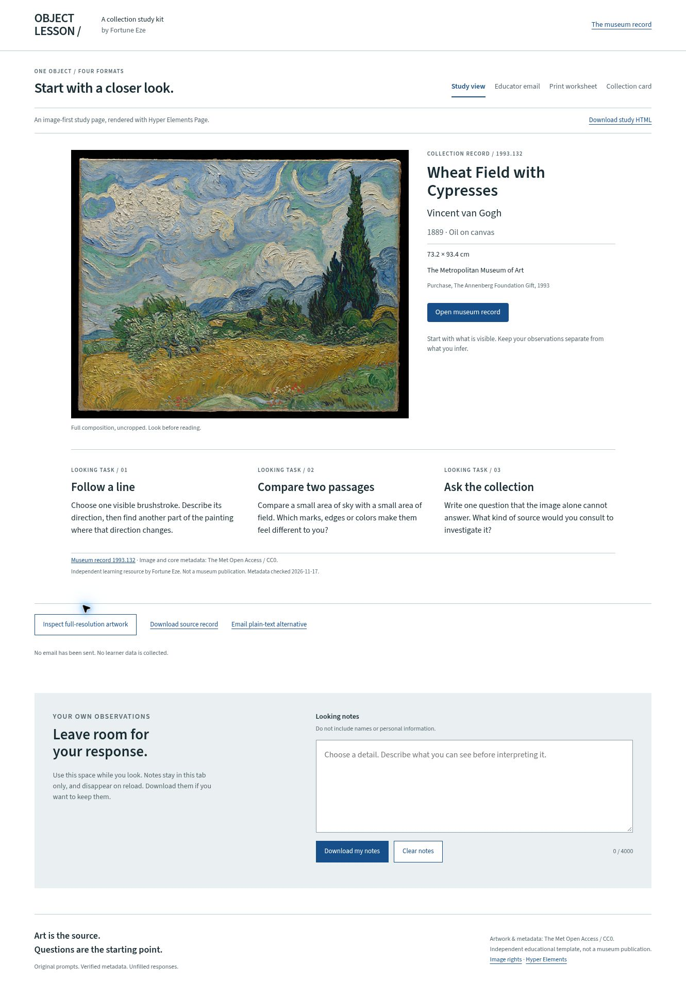

# Object Lesson

**One public-domain artwork, four useful ways to look more closely.**

An independent collection-study kit by Fortune Eze, built with Hyper Elements. Rather than repeating the same composition four times, it turns a verified museum record into an image-first study page, a concise educator email, a printable observation worksheet, and a collection card. The website also provides a full-resolution inspection view and a private, in-tab notebook with text export.



## Run it

Node 22 or later recommended.

```sh
npm ci
npm run build
npm run typecheck
npm test
npm run dev -- --host 127.0.0.1 --port 4173
```

Open `http://127.0.0.1:4173`. Build first: the server serves `dist/`. No API key, account, database, analytics, or runtime artwork API is required. Package installation needs network access. The email uses the museum's remote image URL; a mail client may block external images. The other rendered formats embed the bundled image.

## Four native outputs

| Output | Hyper Elements root | Purpose |
| --- | --- | --- |
| `dist/study.html` | `Page` | Full composition, collection identity, original prompts and source attribution; responsive stacking |
| `dist/email.html` + `email.txt` | `Email` | Educator introduction, image, three prompts, museum link and plain-text alternative |
| `dist/worksheet.pdf` | `Document` / `Document.Page` | A4, one explicit page; three unfilled response areas, no student names or invented answers |
| `dist/collection-card.png` | `Canvas` | 1200 × 720, uncropped artwork, compact identity and source URL |

`src/templates.tsx` uses real library primitives (`Column`, `Row`, `Text`, `Heading`, `Image`, `Divider`, `Link`, `Button`, `LineBreak`) and a shared theme. PDF and PNG come from `renderPdf` and `renderImage`, not screenshots. `dist/clients/` contains library-modeled email client previews, not evidence of live email delivery. The interface never sends mail.

## Source integrity

The sample is **Wheat Field with Cypresses**, Vincent van Gogh, 1889, The Metropolitan Museum of Art, accession **1993.132**. The source JSON was fetched from the museum API and checked on 17 November 2026. It is a dated snapshot, not a live gallery-location feed.

- [Official object record](https://www.metmuseum.org/art/collection/search/436535)
- [Official API record](https://collectionapi.metmuseum.org/public/collection/v1/objects/436535)
- [Open Access image policy](https://www.metmuseum.org/policies/image-resources)

The API marks this artwork public domain. Both included photographs are unaltered museum files, licensed for unrestricted use under the museum's Open Access CC0 policy. Metadata is attributed throughout. Original prompts invite observation rather than assert an interpretation or invent an answer. No museum affiliation or educational outcome is claimed. See [ASSETS.md](ASSETS.md) for exact URLs and checksums.

## Adaptation and deliberate limits

This is a verified **single-object edition**, not an arbitrary museum importer. `data/lesson.json` holds display metadata and three editable prompts. `data/met-source.json` is the corresponding first-party evidence. The build refuses key metadata/image mismatches against that source. Prompts are limited to 50-character headings and 180-character questions; there must be exactly three. The fixed PNG contains no custom prompts.

To adapt to another artwork, deliberately replace and verify the whole source package, both images, source validation, UI descriptions, notebook metadata and rights language together; then recheck all layouts. Do not simply swap a title while retaining another artwork's image or CC0 claim. Missing images fail the build instead of showing invented placeholders. The bundled metadata and images are the reviewed output; arbitrary multilingual or unbroken long-token typography is not certified.

The notebook starts empty. Notes are held in the current tab only, disappear on reload, and are not uploaded or stored in cookies/local storage. A text download preserves them when requested. Browser extensions and the device itself are outside this app's privacy guarantees.

## Design and accessibility

The image/identity split follows museum collection records: the object takes priority; interpretation is separate from catalog facts. Source Sans 3 uses the readable academic sans-serif approach documented by Harvard's design system, with a restrained white/slate/cobalt palette. No decorative artwork crop, generated illustration, icon library, or animated embellishment is used. [Design research](RESEARCH.md).

Body, link and muted text meet WCAG AA contrast on both reading surfaces (automated checks). The UI has a skip link, visible focus, labeled controls, text status, semantic headings, responsive stacking, reduced-motion rules and a keyboard-dismissable native inspection dialog. Image scale is keyboard operable. The downloadable image is not a substitute for the accessible HTML version.

## Verification

- 14 automated tests: first-party metadata match, source and path validation, required alt text, prompt bounds, four valid native roots, escaping, remote email image, real PDF/PNG signatures, no notebook network/storage APIs, and text contrast.
- Build and TypeScript checks pass.
- Default PDF and PNG visually inspected. The PDF remains one page with maximum-length accepted prose prompts; run `node --import tsx scripts/stress.tsx` to produce the deliberately labeled QA fixture in `/tmp/`.
- Browser-reviewed desktop and 390px embedded viewport. The latter is responsive-width QA, not a real-device certification. Four format selections, image zoom to 250%, Escape dismissal, empty-note validation, note download and clearing verified.
- [Desktop screenshot](docs/study.jpg), [390px first-screen screenshot](docs/mobile.jpg), [worksheet render](docs/worksheet.png), [collection PNG](docs/card.png).
- Email previews are simulations. Outlook may ignore letter spacing; no live inbox test is claimed.

## Challenge entry

Prepared for the [Hyper Elements Template Challenge](https://github.com/hyper-elements/hyper-elements/discussions/209). Full source and screenshots are published here. The official Hyper Elements repository was starred, and the entry was submitted as [discussion #253](https://github.com/hyper-elements/hyper-elements/discussions/253). There is no guaranteed prize or payment.

Original code and prompts: MIT. Museum assets/core metadata: CC0. Font: SIL Open Font License. See `LICENSE` and `ASSETS.md`.
